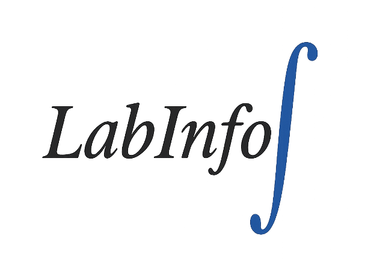
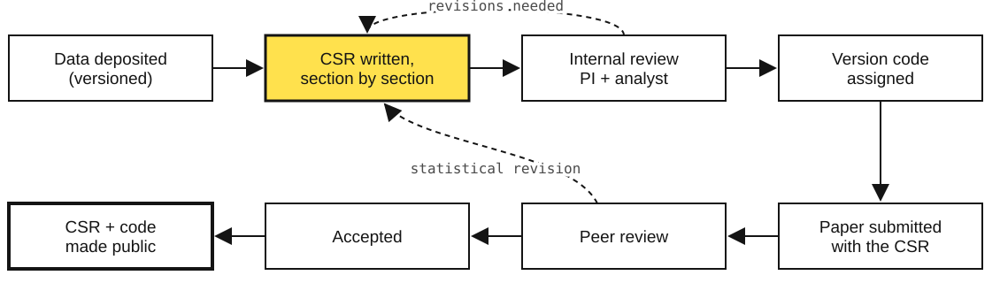
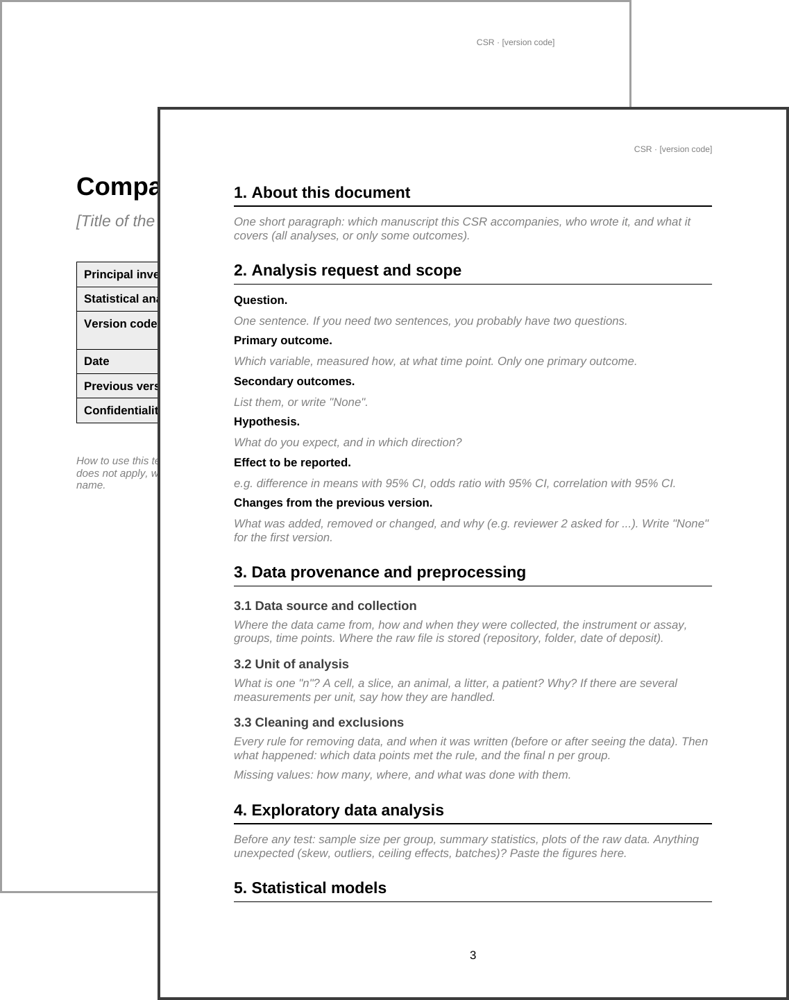
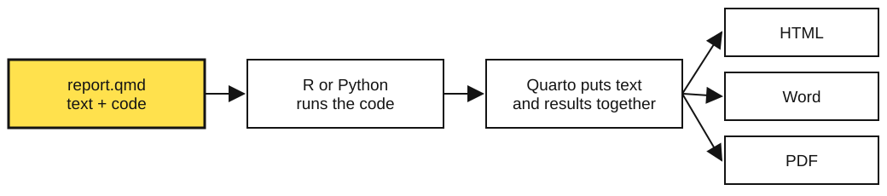
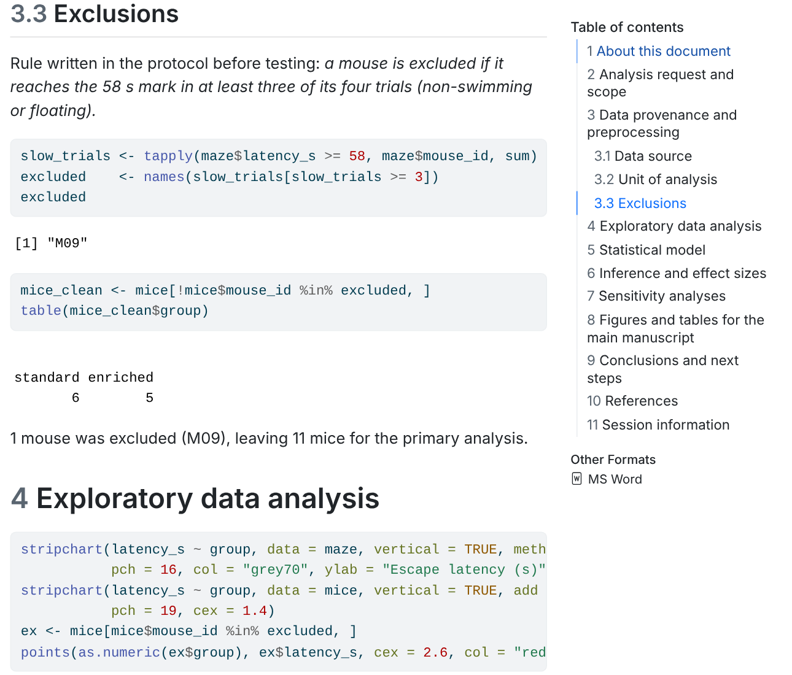




## {.titleslide}

```{webr}
#| include: false
#| autorun: false
# Hidden setup: loads the teaching data set for the first demo.
maze <- read.csv("maze.csv")
maze$group <- factor(maze$group, levels = c("standard", "enriched"))
mice <- aggregate(latency_s ~ mouse_id + group, data = maze, FUN = mean)
p_of <- function(d) round(t.test(latency_s ~ group, data = d)$p.value, 5)
```

[NTS School 2026 · Montevideo]{.kicker}

::: {.big-title}
Your paper needs a buddy
:::

::: {.big-sub}
Using companion statistical reports
:::

::: {.who}
**Prof. Dr. Hércules Freitas**<br>
Health Informatics Laboratory (LabInfoS) · Bertrand Russell Research Excellence Group (NEC)<br>
School of Medicine, Rio de Janeiro State University (UERJ), Brazil
:::

::: {.nts}
{height="130"}
:::

::: {.logos}
{height="180"}
:::

## A sentence you have read a hundred times

::: {.methods-quote}
"Data were analysed with Student's t-test. A value of p < 0.05 was considered significant."
:::

<br>

What this sentence does **not** tell you:

::: {.incremental}
- what counted as one observation (a cell? a slice? an animal?)
- which data points were removed, and why
- whether the test's assumptions were checked
- which other analyses were tried before this one
- how big the effect was, and how uncertain
:::

::: notes
0:00 to 0:05. Open with this. Ask: "Who wrote a sentence like this in a thesis or paper?" Most hands go up. Then: "Who could reproduce their own analysis from six months ago, from that sentence alone?" Fewer hands.
:::

## Plan for the next 90 minutes

| Time | Part |
|:-----|:-----|
| 0:00 | Why the analysis needs to be planned |
| 0:20 | Meet the buddy: the Companion Statistical Report (CSR) |
| 0:35 | A CSR with zero code: the Word version |
| 0:50 | The same CSR in Quarto, running live on these slides |
| 1:10 | **Your turn:** start the CSR of your own project |
| 1:25 | Take-home messages |

<br>

[No programming experience needed. The code on these slides runs in your browser: you can edit it and press **Run**.]{.small .muted}

::: notes
Reassure the audience that nobody has to install anything for the first hour.
:::

## Same data, four honest analysts {.divider .center background-color="#141414"}

[01 · why plan]{.num}

Why a study needs a plan before it needs a test

::: notes
0:05. Part 1 runs until about 0:20.
:::

## The study

Does an **enriched cage** (toys, tunnels, running wheel) improve spatial memory in mice?

:::: {.columns}
::: {.column width="50%" .justify}
- 12 mice: 6 standard cages, 6 enriched cages
- Morris water maze, probe day
- 4 trials per mouse, each capped at 60 s
- Outcome: **escape latency** (seconds to find the platform)
- Lower latency = better memory
:::

:::{.column width="5%"}

:::

::: {.column width="40%"}
```{webr}
#| startover: true
#| autorun: false
maze[16:30, ]
```
:::
::::

[Simulated data, made for this class.]{.tiny .muted}

::: notes
Explain the maze briefly for students outside behaviour. Point out that the table has one row per trial, so 48 rows, but only 12 animals.
:::

## Two decisions nobody wrote down

:::: {.columns}
::: {.column width="50%"}
::: {.box}
### Decision 1: what is "n"?
48 trials, or 12 mice?

The cage was given to the **mouse**. Four trials from the same mouse are not four independent animals.
:::
:::

::: {.column width="50%"}
::: {.box}
### Decision 2: mouse M09
Took ≥ 58 s in all four trials. It floated and did not search.

Keep it? Remove it? Was there a rule **before** the experiment?
:::
:::
::::

<br>

Each choice is defensible. Four analysts could make four different combinations.

::: notes
Ask the room to vote for each decision before showing the next slide. Write the votes on the board if possible.
:::

## Press Run

```{webr}
#| autorun: false
data.frame(
  unit    = c("trial", "trial",    "mouse", "mouse"),
  M09     = c("kept",  "excluded", "kept",  "excluded"),
  p_value = c(p_of(maze),
              p_of(subset(maze, mouse_id != "M09")),
              p_of(mice),
              p_of(subset(mice, mouse_id != "M09")))
)
```

. . .

::: {.statement}
Same data. p goes from [0.00007]{.mark} to [0.53]{.mark}.
:::

::: notes
Press Run live. Let the numbers sink in. Nobody cheated: each row is something a reasonable person could do. The problem is that the paper would only show one row, and the reader would not know which one, or why.
:::

## What the data look like

```{webr}
#| autorun: false
#| fig-height: 4.4
stripchart(latency_s ~ group, data = maze, vertical = TRUE, method = "jitter",
           pch = 16, col = "grey70", ylab = "Escape latency (s)", ylim = c(0, 62))
stripchart(latency_s ~ group, data = mice, vertical = TRUE, add = TRUE, 
           pch = 19, cex = 1.6, col = "black")
```

[Grey: single trials. Black: mean of each mouse. The black dot at the top of "enriched" is M09.]{.small}

::: notes
Show that the trial-level analysis inflates n (48 instead of 12). And that one mouse moves the whole enriched group.
:::

## This has a name

**Analytic flexibility** (the "garden of forking paths"): many small, reasonable decisions, each made *after* seeing the data, each pushing in the direction we hope for.

<br>

::: {.incremental .justify}
- It is not fraud. Most of the time nobody notices they are doing it.
- It inflates false positives (Simmons et al., 2011).
- It is **invisible** in a methods section.
- The cure is boring: decide first, write it down, report what you did.
:::

<br>

[Simmons JP, Nelson LD, Simonsohn U. *Psychol Sci* 2011;22:1359. Gelman A, Loken E. The garden of forking paths, 2013.]{.tiny .muted}

## Planning means answering these before you look

:::: {.columns}
::: {.column width="45%" .justify}
1. What is the question, and the **primary outcome**?
2. What is the **unit** of analysis?
3. How many units, and why that number?
4. What are the **exclusion rules**?
:::

::: {.column width="5%"}
:::

::: {.column width="45%" .justify}
5. Which **model or test**, and what does it assume?
6. Which **effect size** will be reported, with which interval?
7. What will you check to see if the conclusion is robust?
:::
::::

<br>

::: {.box-grey}
If these answers live only in your head, they will change when you see the results. If they live in a document with a date, they will not.
:::

## Isn't sharing the code enough?

:::: {.columns}
::: {.column width="45%"}
::: {.statement}
[74%]{.mark} of R scripts deposited with research data did not run.
:::

After automatic fixes: still **56%**.
:::

::: {.column width="5%"}

:::

::: {.column width="50%" .justify}
Main reasons:

- files read from paths that exist only on the author's computer
- packages that were not declared
- no record of software versions

<br>

And a script that runs still does not say **why** a choice was made.
:::
::::

<br>

[Trisovic A, Lau MK, Pasquier T, Crosas M. A large-scale study on research code quality and execution. *Sci Data* 2022;9:60.]{.tiny .muted}

## What we already have, and what is missing

| Layer of the study | Existing tool |
|:-----|:-----|
| Hypotheses, before data collection | Preregistration |
| Raw observations | Data sharing mandates |
| Animals, housing, procedures | ARRIVE 2.0, CONSORT, STROBE |
| **Every decision from raw data to the p-value in the paper** | [?]{.mark} |

<br>

The statistical layer is the one with no standard home.

::: notes
0:18 to 0:20. Transition: "This is where the buddy comes in."
:::

## Meet the buddy {.divider .center background-color="#141414"}

[02 · the companion statistical report]{.num}

::: notes
0:20. Part 2 runs until about 0:35.
:::

## The Companion Statistical Report

::: {.statement}
A structured, versioned, executable document that is written alongside the paper and reviewed with it.
:::

<br>

:::: {.columns}
::: {.column width="50%"}
### The paper says
*what* was found
:::
::: {.column width="50%"}
### The CSR says
*how* we got there, and *why* each choice was made
:::
::::

<br>

[Salgado Ramos MC, da Câmara AO, Freitas HR. From pipettes to p-values: a framework for companion statistical reporting in experimental neuroscience. *Standards* 2026;6(2):13. doi:10.3390/standards6020013]{.tiny .muted}

## Eight sections, in the order of the analysis

:::: {.columns}
::: {.column width="55%" .sections}
1. About this document
2. Analysis request and scope
3. Data provenance and preprocessing
4. Exploratory data analysis
5. Statistical models
6. Inference and effect sizes
7. Sensitivity analyses
8. Figures and tables for the manuscript
:::
::: {.column width="45%"  .justify}
::: {.box-grey}
**Plus three closing sections**

Conclusions and next steps · References · Session information (software and versions)
:::

Each section is a **checkpoint**. You finish it, and justify it, before going to the next.
:::
::::

::: notes
Stress the order: you do not get to section 6 (the p-value) before you have closed section 3 (exclusions). That is the whole trick.
:::

## What goes in each section

| Section | The question it answers |
|:----|:----|
| Analysis request and scope | What exactly are we testing? What changed since the last version? |
| Data provenance | Where did the data come from? What was removed, and by which rule? |
| Exploratory analysis | What do the data look like *before* any test? |
| Statistical models | Which model, why this one, what it assumes, were the assumptions checked? |
| Inference and effect sizes | How big is the effect, with which interval? (p-value comes with it, never alone) |
| Sensitivity analyses | Does the conclusion survive other reasonable choices? |

## Where the buddy sits in a study

{width="100%"}

When a reviewer asks for a new analysis, it goes back into the CSR, not into an edited methods paragraph.

## Every version has a code

<br>

::: {.vcode .center}
[NEC]{.seg} [S01]{.seg} [V03]{.seg} [D1026]{.seg}
:::

<br>

| Part | Meaning |
|:--|:--|
| `NEC` | the group that issues the report (use your own lab prefix) |
| `S01` | service or project number |
| `V03` | third version of the analysis |
| `D1026` | document iteration (*date*)|

The template **refuses to render** if the code is malformed. No unversioned report can circulate.

## Try it: is your version code valid?

```{webr}
#| caption: Change the code between the quotes, then press Run
my_code <- "NECS01V03D1026"

grepl("^NECS\\d{2}V\\d{2}D\\d{4}$", my_code)
```

<br>

::: {.small}
- `TRUE` means the template will render.
- Try `"NECS1V3D42"` or `"necs01v03d0042"`. What happens?
- `\\d{2}` reads as "exactly two digits".
:::

::: notes
First time the students touch code. Ask them to break it on purpose.
:::

## Two limits

:::: {.columns}
::: {.column width="50%" .justify}
::: {.box}
### Transparent is not correct
A CSR can document a bad model very clearly. It does not teach statistics. It makes the choice **visible**, so a reviewer can disagree with it.
:::
:::
::: {.column width="50%" .justify}
::: {.box}
### Sensitive data
Human or clinical data do not need to be public. The CSR, its code and its outputs can be shared without the raw file, or run on synthetic data, or deposited under controlled access.
:::
:::
::::

::: notes
0:33 to 0:35. Common questions here: "Does the journal accept it?" Answer: any journal with Supplementary Materials accepts it today.
:::

## A CSR with zero code {.divider .center background-color="#141414"}

[03 · start in Word]{.num}

You can begin today, with the software you already have.

::: notes
0:35. Part 3 runs until about 0:50.
:::

## The Word template

:::: {.columns}
::: {.column width="45%"}
{fig-align="center" height="560"}
:::
::: {.column width="55%" .justify}
`CSR_Template_Word.docx`

- a cover table: title, PI, analyst, **version code**, date
- the eight sections plus the three closing ones
- under each heading, the questions you must answer (grey text: replace it)
- a filled example for the water-maze study: `CSR_Example_WaterMaze.docx`


[The structure is what matters, not the software.]{.small .muted}
:::
::::

## Data provenance: vague vs useful

::: {.bad}
Outliers were removed.
:::

<br>

::: {.good}
Rule written in protocol v1 (2 March 2026), before testing: a mouse is excluded if it reaches 58 s in at least 3 of its 4 trials (floating). One mouse met the rule (M09, enriched group). Final n = 6 standard, 5 enriched.
:::

<br>

[Who decided, when, by which rule, and what happened to n.]{.mark}

## Statistical model: vague vs useful

::: {.bad}
Groups were compared with a t-test.
:::

<br>

::: {.good}
Unit of analysis: the mouse (housing was assigned per mouse). The four trials were averaged within each mouse. Groups compared with Welch's t-test, which does not assume equal variances. With n = 5–6 per group, normality was judged from a dot plot rather than a formal test.
:::

## Inference: vague vs useful

::: {.bad}
Enriched mice performed significantly better (p < 0.05).
:::

<br>

::: {.good}
Standard-housed mice took on average 10.1 s longer to find the platform (95% CI 0.7 to 19.6 s; p = 0.039).
:::

<br>

::: {.box-grey}
**Sensitivity.** With M09 kept, the difference is 4.5 s (95% CI −11.7 to 20.6; p = 0.53). The conclusion depends on the exclusion rule, which is why the rule was fixed in advance and is reported here.
:::

::: notes
This is the most important slide of Part 3: reporting the sensitivity analysis that weakens your result is what makes the main result credible.
:::

## Good habits in the Word version

:::: {.columns}
::: {.column width="45%" .justify}
- Use Word's **heading styles**, so the table of contents builds itself
- Put the version code in the file name: `CSR_NECS01V01D0001.docx`
- Use **track changes** for the internal review with your PI
- Never overwrite: a new analysis is a new version
- Export to PDF when you submit
:::

::: {.column width="5%"}
:::

::: {.column width="45%" .justify}
::: {.box}
### The weak point
Numbers are copied by hand from the statistics software into Word.

Every copy is a chance for a typo, and the next version means copying everything again.
:::
:::
::::

::: notes
0:48 to 0:50. This weak point is the bridge to Part 4.
:::

## The same CSR, now executable {.divider .center background-color="#141414"}

[04 · quarto, live]{.num}

Text, code and results in one file. Numbers are never typed by hand.

::: notes
0:50. Part 4 runs until about 1:10.
:::

## What Quarto does

{fig-align="center"}

- Free and open source ([quarto.org](https://quarto.org)), already inside RStudio and Positron
- One button: **Render**
- If the code fails, the report does not render. A rendered report is proof that the analysis runs.

## Anatomy of a `.qmd` file

````{.markdown filename="csr_demo.qmd"}
---
title: "Companion Statistical Report"
format: [html, docx]
params:
  version_code: "NECS01V01D0001"
---

# Data provenance and preprocessing

The mouse, not the trial, is the unit of analysis.

```{{r}}
maze <- read.csv("maze.csv")
mice <- aggregate(latency_s ~ mouse_id + group, data = maze, FUN = mean)
```
````

:::: {.columns .small}
::: {.column width="33%"}
**Header** between `---`: title, output formats, version code
:::
::: {.column width="33%"}
**Text**: plain writing, `#` makes a heading
:::
::: {.column width="33%"}
**Code chunk**: between ```` ``` ````, runs when you render
:::
::::

## R in two minutes: it is a calculator

```{webr}
#| caption: Edit and press Run (or Ctrl/Cmd + Enter)
2 + 2

trials <- c(13.9, 19.7, 12.7, 11.8)   # the four trials of mouse M07
mean(trials)
```

<br>

::: {.small}
- `<-` stores a value under a name
- `c(...)` puts values together
- `mean()`, `sd()`, `length()` are functions: name, then parentheses
- `#` starts a comment, which R ignores and humans read
:::

## Your first exercise

```{webr}
#| exercise: ex_mean
#| caption: Mean latency of mouse M08 (trials 29.2, 23.4, 29.0 and 14.1)
mean(c(29.2, 23.4, 29.0, ______))
```

```{webr}
#| exercise: ex_mean
#| check: true
if (isTRUE(all.equal(.result, 23.925))) {
  list(correct = TRUE, message = "Correct. You just computed a mouse mean.")
} else {
  list(correct = FALSE, message = "Not yet. Replace ______ with the fourth trial.")
}
```

::: {.hint exercise="ex_mean"}
The fourth trial of M08 was 14.1 s.
:::

::: notes
Give one minute. Walk around. This is just to lose the fear of the editor.
:::

## CSR § 3 · Data import

```{webr}
#| autorun: false
#| fig-height: 3
maze <- read.csv("maze.csv")
maze$group <- factor(maze$group, levels = c("standard", "enriched"))

str(maze)
table(maze$group) / 4      # number of mice per group
```

[`read.csv()` reads the file **next to the report**, never from `C:/Users/me/Desktop`. Paths that exist only on the author's computer are one of the main reasons shared code fails.]{.small}

## CSR § 3 · Unit of analysis and exclusions

```{webr}
#| autorun: false
# one row per mouse: the mean of its 4 trials
mice <- aggregate(latency_s ~ mouse_id + group, data = maze, FUN = mean)

# rule from the protocol: >= 3 trials at 58 s or more -> exclude
slow_trials <- tapply(maze$latency_s >= 58, maze$mouse_id, sum)
excluded    <- names(slow_trials[slow_trials >= 3])
excluded

mice_clean <- subset(mice, !mouse_id %in% excluded)
table(mice_clean$group)
```

::: notes
The rule is written as code. Anyone can see it, change the threshold, and see what happens. Invite a student to change 58 to 50 and run it again.
:::

## CSR § 4 · Look before you test

```{webr}
#| autorun: false
#| fig-height: 4.2
#| fig-width: 3.5
aggregate(latency_s ~ group, data = mice_clean,
          FUN = function(x) round(c(n = length(x), mean = mean(x), sd = sd(x)), 1))

stripchart(latency_s ~ group, data = mice_clean, vertical = TRUE,
           pch = 19, cex = 1.6, ylab = "Mean escape latency (s)", ylim = c(0, 60))
```

## CSR § 5–6 · Model, effect size and interval

```{webr}
#| autorun: false
res <- t.test(latency_s ~ group, data = mice_clean)   # Welch's t-test

difference <- res$estimate[1] - res$estimate[2]
round(c(difference = unname(difference),
        ci_low     = res$conf.int[1],
        ci_high    = res$conf.int[2],
        p_value    = res$p.value), 3)
```

<br>

[The difference and its interval come first. The p-value comes with them, never alone.]{.small}

## CSR § 7 · Sensitivity: does it survive?

```{webr}
#| autorun: false
res_all <- t.test(latency_s ~ group, data = mice)   # M09 kept

round(c(difference = unname(res_all$estimate[1] - res_all$estimate[2]),
        ci_low     = res_all$conf.int[1],
        ci_high    = res_all$conf.int[2],
        p_value    = res_all$p.value), 3)
```

<br>

::: {.box-grey .small}
This result **weakens** the main finding, and it goes in the report anyway. A reader who sees it trusts the main result more, not less.
:::

## Numbers inside sentences

In the `.qmd` file you write:

```{=html}
<div class="snippet">Standard-housed mice took on average &#96;r round(difference, 1)&#96; s longer
(95% CI &#96;r round(res$conf.int[1], 1)&#96; to &#96;r round(res$conf.int[2], 1)&#96; s).</div>
```

and the rendered report reads:

::: {.box}
Standard-housed mice took on average 10.1 s longer (95% CI 0.7 to 19.6 s).
:::

<br>

Change the data, press Render, and every number in every sentence updates. No copying, no typos.

## CSR § 11 · Session information

```{webr}
#| autorun: false
sessionInfo()
```

[The exact R version and packages that produced the results. (Here it shows the version of R that is running inside this browser tab.)]{.small}

## The rendered report

:::: {.columns}
::: {.column width="58%"}
{height="590"}
:::
::: {.column width="42%" .justify}
`csr_demo.qmd` → **Render** →

- `csr_demo.html`
- `csr_demo.docx`

<br>

Uses **base R only**: no packages to install.

To adapt it: change the `params`, replace `maze.csv` with your data, rewrite the text of each section.
:::
::::

::: notes
If time allows, open csr_demo.qmd in RStudio and press Render live. Takes about 5 seconds.
:::

## From the demo to the full template

[github.com/drhrf/CSReport](https://github.com/drhrf/CSReport)

:::: {.columns}
::: {.column width="50%"  .justify}
1. Click **Use this template** on GitHub
2. Fill in the `params` block: title, PI, analyst, version code, logo
3. Write each section, replacing the guidance text
4. Render with Quarto
:::

::: {.column width="5%"}
:::

::: {.column width="40%"}
::: {.box-grey .small}
- PDF output via XeLaTeX, with title page and logo
- R by default, Python blocks ready to switch on
- Version code checked at every render
- Free for any use (Creative Commons 4.0)
:::
:::
::::

::: notes
1:08 to 1:10. Transition to the hands-on.
:::

## Your turn {.divider .center background-color="#141414"}

[05 · start the CSR of your own project]{.num}

15 minutes. You will not finish. You will start.

::: notes
1:10. Hands-on until about 1:25.
:::

## Pick a track

:::: {.columns}
::: {.column width="50%"}
::: {.box}
### Track A · Word
Everyone can do this one.

Open `CSR_Template_Word.docx` and write sections 1 to 3 and section 5 for **your** project.

Keep `CSR_Example_WaterMaze.docx` open beside it as a model.
:::
:::
::: {.column width="50%"}
::: {.box}
### Track B · Quarto
For those with R and RStudio (or a free account at [posit.cloud](https://posit.cloud)).

Open `csr_demo.qmd` with `maze.csv`, press **Render**, then change the params and the text of sections 1 to 3 for **your** project.
:::
:::
::::

<br>

[A project you have, a project you are planning, or a paper you are writing. Data are not needed today.]{.small .muted}

## Steps

:::: {.columns}
::: {.column width="55%" .justify}
1. **Cover**: title, your name, your PI, a version code (2 min)
2. **Scope**: one question, one primary outcome, the effect you will report (4 min)
3. **Provenance**: what is your unit of analysis? What is your exclusion rule, written now? (4 min)
4. **Model**: which test or model, and what it assumes (3 min)
5. **Buddy review**: swap with your neighbour (next slide)
:::

::: {.column width="5%"}

:::

::: {.column width="40%"}
::: {.timer-wrap data-minutes="13"}
:::
:::
::::

::: notes
Walk around the room. The most common difficulty is the unit of analysis; help with that first.
:::

## Buddy review

Swap documents with your neighbour. Ask these questions about **their** CSR:

:::: {.columns}
::: {.column width="55%" .justify}
1. Could I say in one sentence what is being tested?
2. Do I know what one "n" is?
3. If a data point looks strange, do I know what will happen to it?
4. Do I know which number will be the main result?
5. Is there anything that was decided after seeing the data?
:::

:::{.column width="5%"}

:::

::: {.column width="40%"}
::: {.timer-wrap data-minutes="4"}
:::

:::
::::

## Take-home {.divider .center background-color="#141414"}

[06 · wrap-up]{.num}

## Three things to keep in mind

::: {.statement .st-justify}
1. Decide before you look, and write down the date.
:::

::: {.statement .st-justify}
2. Report the effect and its interval, and the analysis that could have changed your mind.
:::

::: {.statement .st-justify}
3. Give your paper a buddy. Word today, Quarto when you are ready.
:::

::: notes
1:25. Leave the last 5 minutes for questions.
:::

## Resources

:::: {.columns}
::: {.column width="50%"}
**Template and paper**

- CSR template: [github.com/drhrf/CSReport](https://github.com/drhrf/CSReport)
- Paper: Salgado Ramos, da Câmara & Freitas, *Standards* 2026;6(2):13. [doi:10.3390/standards6020013](https://doi.org/10.3390/standards6020013)

**Today's files**

- `CSR_Template_Word.docx`, `CSR_Example_WaterMaze.docx`
- `csr_demo.qmd`, `maze.csv`
:::
::: {.column width="50%"}
**To learn the tools**

- Quarto: [quarto.org/docs/get-started](https://quarto.org/docs/get-started/)
- R for absolute beginners: [r4ds.hadley.nz](https://r4ds.hadley.nz)
- R in the browser, no install: [webr.r-wasm.org](https://webr.r-wasm.org/latest/)
- Ten simple rules for reproducible computational research: Sandve et al., *PLoS Comput Biol* 2013;9:e1003285
:::
::::

## Thank you {.center}

<br>

::: {.statement .center style="margin: 0 auto;"}
Questions?
:::

<br>

::: {.center}
**Hércules Rezende Freitas**

hercules.freitas@uerj.br · [labinfos.org](https://labinfos.org)

{height="230"}
:::
